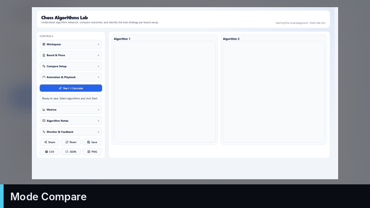
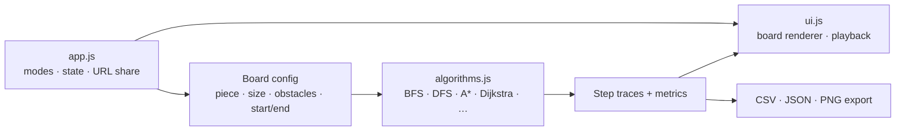

<div align="center">


# ♞ Chess Algorithms Lab

### Learning-first visual lab for chess pathfinding — race BFS, DFS, A*, Dijkstra and more on any board

   

[](LICENSE)    

[](https://codespaces.new/shiroonigami23-ui/Chess-Algorithms-?quickstart=1) [](https://github.com/shiroonigami23-ui/Chess-Algorithms-/archive/refs/heads/main.zip)

[**🚀 Live Demo**](https://shiroonigami23-ui.github.io/Chess-Algorithms-/) · [**Overview**](#-overview) · [**Features**](#-features) · [**Architecture**](#-architecture) · [**Getting Started**](#-getting-started) · [**Roadmap**](#-roadmap)

</div>

---

## 📸 Preview

<p align="center"></p>

## 📖 Overview

**Chess Algorithms Lab** makes graph search tangible: place a chess piece, set a start and a goal, add obstacles, and watch
algorithms explore the board move by move. **Race** several algorithms on the same setup, **compare** them side by side,
study one in **Path** mode, play the **Knight's Tour**, view a **reachability heat-map**, or read the built-in **Learn**
notes. Every run produces metrics you can export as CSV, JSON or PNG, and any configuration can be shared as a URL.
It's 100 % client-side and deployed to GitHub Pages.

### ✨ Highlights

- **8 algorithms** — BFS, DFS, A*, Dijkstra, Quantum, Bidirectional BFS, Knight's Tour, Heatmap
- **6 pieces** — knight, rook, bishop, queen, king, pawn on 4×4 → 16×16 boards
- **Six modes** — Race, Path, Compare, Tour, Heatmap, Learn
- **Shareable experiments** — URL configs + CSV/JSON/PNG export

## 🧩 Features

| Feature | What it does |
|---|---|
| **Race mode** | Multiple algorithms compete on the same board |
| **Compare mode** | Side-by-side metrics and paths |
| **Path mode** | Deep-dive into one algorithm |
| **Knight's Tour** | Visualised tour construction |
| **Heatmap** | Distance-to-reach map for any piece |
| **Playback** | Play / pause / step / restart with speed control |
| **Board editor** | Obstacles, start/end, size 4–16 |
| **Themes** | Light / dark / classic |
| **Export** | CSV, JSON, PNG and shareable URLs |

## 🛠 Tech Stack

| Layer | Technology |
|---|---|
| Front-end | Vanilla JavaScript, HTML5, CSS3 |
| Assets | Maestro SVG piece set |
| Hosting | GitHub Pages (`pages.yml`) |
| CI | GitHub Actions |

## 🏗 Architecture

Algorithms are pure functions producing step traces; the UI replays traces on the board.



➡️ Full design notes, data flow and design decisions: **[docs/ARCHITECTURE.md](docs/ARCHITECTURE.md)**

## 📁 Project Structure

```text
Chess-Algorithms-/
├── index.html · styles.css
├── app.js           # modes, state, sharing
├── algorithms.js    # search algorithms + metrics
├── ui.js            # rendering & playback
├── assets/pieces/maestro/
└── docs/screenshots/
```

## 🚀 Getting Started

### Prerequisites

- Any modern browser

### 1. Get the code

Pick whichever method suits you:

| Method | Command |
|---|---|
| **HTTPS** | `git clone https://github.com/shiroonigami23-ui/Chess-Algorithms-.git` |
| **SSH** | `git clone git@github.com:shiroonigami23-ui/Chess-Algorithms-.git` |
| **GitHub CLI** | `gh repo clone shiroonigami23-ui/Chess-Algorithms-` |
| **ZIP** | [Download](https://github.com/shiroonigami23-ui/Chess-Algorithms-/archive/refs/heads/main.zip) and extract |
| **Codespaces** | [Open in browser](https://codespaces.new/shiroonigami23-ui/Chess-Algorithms-?quickstart=1) — zero local setup, dev container preconfigured |

> 🔑 **Using SSH for the first time?** Generate a key with `ssh-keygen -t ed25519 -C "you@example.com"`, add the `.pub` contents at **GitHub → Settings → SSH and GPG keys**, then test with `ssh -T git@github.com`.

### 2. Install & set up

```bash
cd Chess-Algorithms-
python3 -m http.server 8080      # open http://localhost:8080
```

### 3. Run

Or use the live site: **https://shiroonigami23-ui.github.io/Chess-Algorithms-/**

## 🗺 Roadmap

**v1 — Lab (done)**

- [x] 8 algorithms, 6 pieces, 6 modes
- [x] Playback, themes, export, URL sharing, Pages deploy

**v1.1**

- [ ] Greedy best-first and IDA* algorithms
- [ ] Weighted squares (terrain costs)
- [ ] Step-by-step pseudo-code highlighting

**v1.2**

- [ ] Classroom mode with guided exercises
- [ ] Benchmark suite across random boards with charts

➡️ Detailed plan, milestones and long-term vision: **[docs/ROADMAP.md](docs/ROADMAP.md)**

## 🤝 Contributing

Contributions, issues and feature requests are welcome!

1. Fork the repository
2. Create a feature branch: `git checkout -b feature/amazing-feature`
3. Commit your changes: `git commit -m "feat: add amazing feature"`
4. Push the branch: `git push origin feature/amazing-feature`
5. Open a Pull Request against `main`

Check the [issues page](https://github.com/shiroonigami23-ui/Chess-Algorithms-/issues) and the [roadmap](docs/ROADMAP.md) for ideas on where to help.

## 📜 Changelog

See [CHANGELOG.md](CHANGELOG.md) for the release history.

## 📄 License

Distributed under the **MIT** license. See [LICENSE](LICENSE) for details.

## 👤 Author

**Aryan Singh Chandel** (Shiro)

[](https://github.com/shiroonigami23-ui)

<div align="center">

⭐ **If you find this project useful, consider giving it a star!** ⭐

</div>
