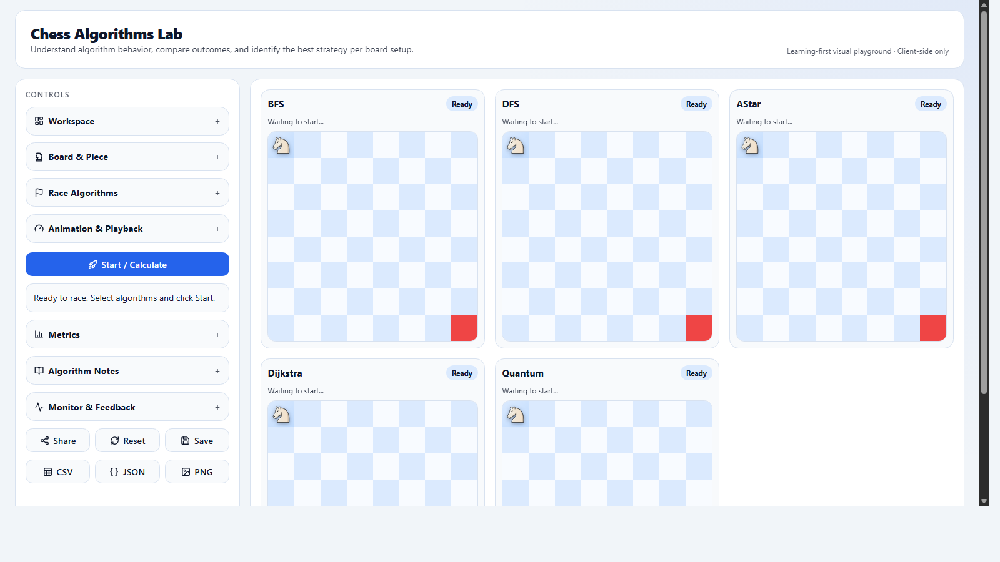
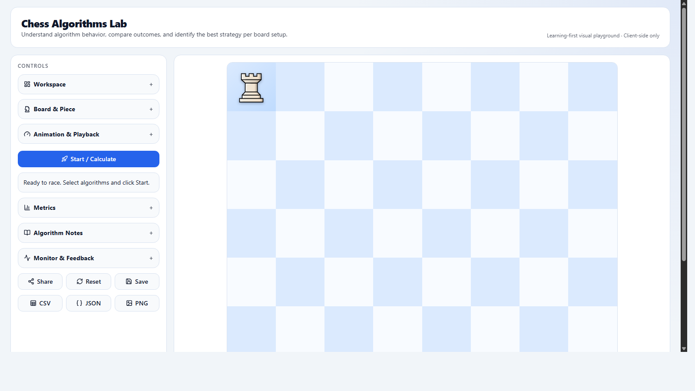
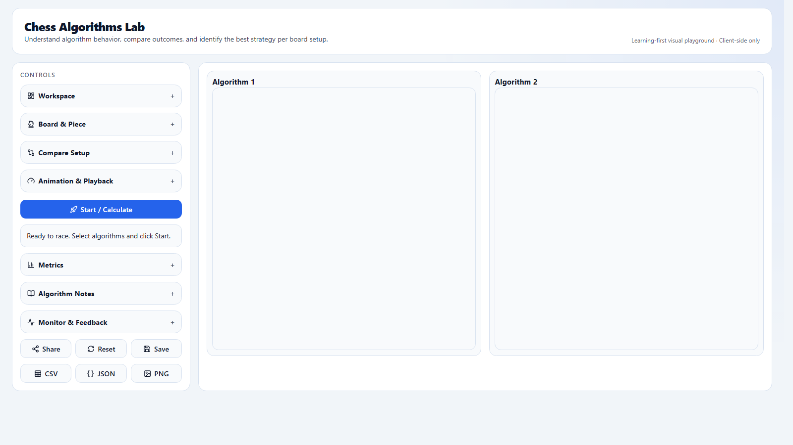

# Chess Algorithms Lab

Professional, learning-first visual platform to understand chess-pathfinding algorithms, compare them objectively, and identify the best algorithm for a given board configuration.

## Live Links
- Live site: **https://shiroonigami23-ui.github.io/Chess-Algorithms-/**
- Repository: **https://github.com/shiroonigami23-ui/Chess-Algorithms-**
- Issues / feedback: **https://github.com/shiroonigami23-ui/Chess-Algorithms-/issues**

## Quick Navigation
- [What this project is for](#what-this-project-is-for)
- [Core features](#core-features)
- [Screenshots](#screenshots)
- [Local run (recommended)](#local-run-recommended)
- [GitHub workflows](#github-workflows)

## What this project is for
- Study algorithm behavior step-by-step on chess boards.
- Compare speed, path quality, and exploration cost.
- Run reproducible experiments with saved/shareable configurations.

## Core features
- Modes:
  - `Race`: multi-algorithm competition on same setup.
  - `Path`: single algorithm analysis with selectable algorithm.
  - `Compare`: side-by-side algorithm comparison.
  - `Tour`: Knight's Tour visualization.
  - `Heatmap`: reachability distance map.
  - `Learn`: in-app algorithm explanations.
- Algorithms:
  - `BFS`, `DFS`, `A*`, `Dijkstra`, `Quantum`, `Bidirectional BFS`
  - `Knight's Tour`, `Heatmap`
- Chess pieces:
  - `Knight`, `Rook`, `Bishop`, `Queen`, `King`, `Pawn`
  - Visual piece assets are bundled in `assets/pieces/maestro/`
- Professional controls:
  - Collapsible control sections (collapsed by default)
  - Variable board size (`4x4` to `16x16`)
  - Speed + playback controls (`play/pause/step/restart`)
  - Obstacles and start/end placement
  - Theme system (`light/dark/classic`)
- Data and export:
  - `CSV`, `JSON`, and `PNG` export
  - Shareable URL configs
  - Local save snapshots
- Reliability:
  - In-app monitor feed (events, warnings, runtime errors)
  - Exportable monitor log (`monitor-log.json`)

## Screenshots

### Home / Race View


### Heatmap View


### Compare View


## Local run (recommended)
Run with a local server (fewer browser restrictions and better export behavior):

```powershell
cd C:\Users\shiro\OneDrive\Desktop\Presentation\Chess-Algorithms-
python -m http.server 8080
```

Open: `http://localhost:8080`

## Usage flow
1. Select `Mode`.
2. Set board size, piece, and start/end positions.
3. Add obstacles with right-click.
4. In `Path` mode, choose `Path Algorithm`.
5. Click `Start / Calculate`.
6. Review metrics and monitor feed.
7. Export outputs (`CSV/JSON/PNG`) as needed.

## Monitoring and feedback loop
Use the **Monitor & Feedback** panel while testing:
- Tracks state changes and run outcomes.
- Captures runtime errors and unhandled rejections.
- Use `Export Log` to share exact issues and traces.

## GitHub workflows
This repo includes:
- `.github/workflows/ci.yml`
  - Syntax validation (`node --check`) for core JS files on push/PR.
- `.github/workflows/pages.yml`
  - Static deployment to GitHub Pages on `main`.

## Project structure
- `index.html` - UI layout and control IDs.
- `styles.css` - theme + component styling.
- `ui.js` - board rendering and UI state toggles.
- `algorithms.js` - algorithm implementations.
- `app.js` - app controller, mode logic, monitoring, exports.
- `docs/screenshots/` - screenshot assets used in README.
- `assets/pieces/maestro/` - bundled chess piece SVG assets.

## Current quality target
- Every visible control should trigger real behavior.
- Every algorithm run should produce measurable stats.
- Every failure should be visible in monitor feed.

## Next engineering upgrades
- Add weighted-cell mode for richer Dijkstra/A* demos.
- Add benchmark batch runner across randomized boards.
- Add deterministic test fixtures for algorithm correctness snapshots.
- Add accessibility pass (keyboard-only board control).
