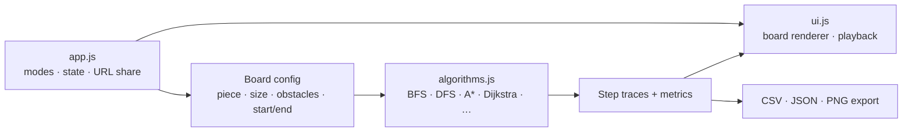

# 🏗 Architecture — Chess Algorithms Lab

> Part of [Chess-Algorithms-](https://github.com/shiroonigami23-ui/Chess-Algorithms-). Back to the [README](../README.md).

## 1. System Overview

`algorithms.js` implements each search over a board graph defined by the piece's move set and returns a sequence of
visited/frontier states plus metrics. `app.js` manages modes and configuration; `ui.js` renders the board and animates traces.

## 2. Components

| Component | Location | Responsibility |
|---|---|---|
| **Algorithms** | `algorithms.js` | Search implementations and metrics |
| **App** | `app.js` | Modes, state, sharing, export |
| **UI** | `ui.js` | Board drawing, piece assets, playback |

## 3. Data / Control Flow

1. The user configures a board and picks a mode.
2. Algorithms compute traces; metrics are tabulated.
3. The UI animates traces; results can be exported or shared.

## 4. Key Design Decisions

| Decision | Rationale |
|---|---|
| Precomputed traces | Deterministic playback and fair comparisons |

## 5. Known Limitations

- The Quantum algorithm is a heuristic simulation, not real quantum computing

---
*Last updated: 2026-11-13*
